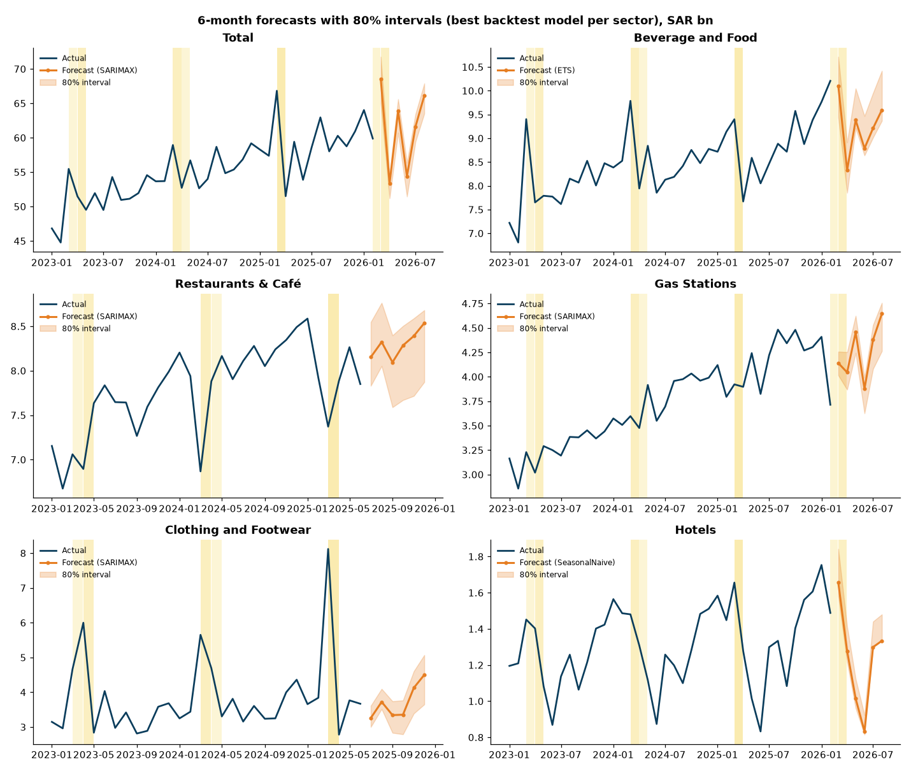
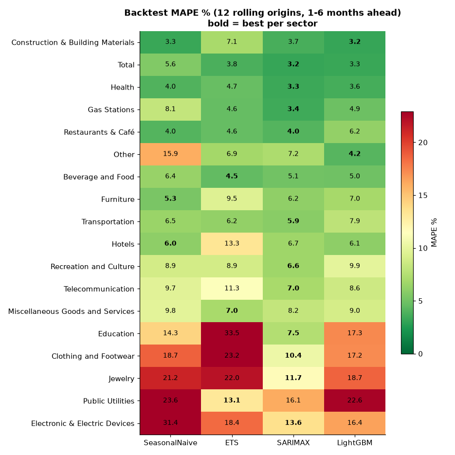
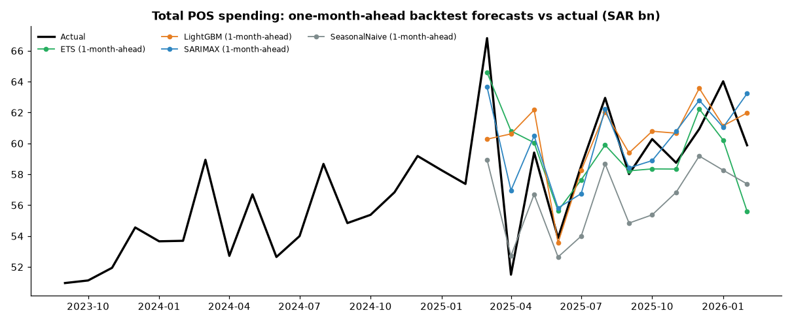
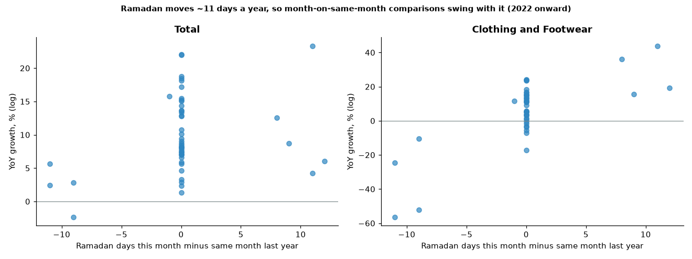

# KSA Consumer Spending Nowcast: monthly forecasts of Saudi POS card spending by sector

**Monthly forecasts and a nowcast of Saudi point-of-sale (POS) card spending for 17 merchant sectors plus the national total, built on official Saudi Central Bank (SAMA) data. Four models are compared in a rolling-origin backtest, and the Ramadan and Eid features are computed from the Hijri calendar.**

Author: **Amir Khan** · Python · statsmodels · LightGBM · hijridate · pytest



---

## 1. Business question

Retailers, banks, mall operators and FMCG brands in Saudi Arabia plan stock, staff and campaigns a month or a quarter ahead. SAMA publishes card spending at points of sale every week, but no one publishes an official forecast. This project answers:

1. **How much will consumers spend at points of sale next month, and over the next 3 to 6 months, in each sector?** It gives a point forecast plus an 80% range.
2. **Which forecasting method should a planning team trust for each sector?** Every model has to beat a seasonal-naive baseline out of sample.
3. **How much of the month-to-month swing is just the calendar?** Ramadan and the two Eids move about 11 days earlier each Gregorian year. A March can hold all of Ramadan one year and none of it a few years later, so month dummies alone cannot capture the effect.

## 2. Data and source

| | |
|---|---|
| Publisher | Saudi Central Bank (SAMA), weekly POS bulletin |
| Access | KAPSARC Data Portal public CSV exports. Exact URLs, SHA-256 and download times are in [`data/raw/SOURCES.md`](data/raw/SOURCES.md) and [`data/raw/manifest.json`](data/raw/manifest.json) |
| Reused from | my [ksa-pos-spending-dashboard](https://github.com/amirator/ksa-pos-spending-dashboard) project (same raw files) |
| Coverage | Weekly national value by sector, 10 May 2020 to 22 Mar 2026 |
| Modelled series | 18 monthly series (17 sectors + Total), Jul 2020 onward, in SAR bn |
| License | Labelled Public Domain on KAPSARC; source copyright SAMA |

**Preparation** ([`src/nowcast/data.py`](src/nowcast/data.py)):
- **Weekly to monthly.** Each Sunday-to-Saturday week is spread evenly over its 7 days, and the days are summed by calendar month. Only months with full coverage are kept. A test checks that value is conserved.
- **Splicing two bulletins.** In mid-2025 SAMA moved to a new, more detailed sector list (bulletin B). A sector is extended with B only if the two bulletins agree within 1% in both overlap weeks. Five series pass, with gaps of 0.0% to 0.09%: **Total, Beverage and Food, Gas Stations, Hotels, Public Utilities**. These run to **Feb 2026** (68 months). The other 12 sectors were re-cut, with gaps of 6% to 80% ([`splice_audit.csv`](data/processed/splice_audit.csv)), so they stop at **Jun 2025** (60 months) rather than mixing definitions.
- **One source error fixed and logged.** Gas Stations in the week of 1 Feb 2026 is reported as SAR 63.3 m against about SAR 0.9 bn in the weeks around it, which looks like a dropped digit. A rule replaces isolated values below 25% of the local median with the mean of the two adjacent weeks. Ramadan, Eid and Hajj weeks are excluded from the rule because real closures happen then (Education drops about 95% in Eid weeks). This was the only value the rule changed ([`data_corrections.csv`](data/processed/data_corrections.csv)).

## 3. Method

| Step | Detail | Borrowed from |
|---|---|---|
| Tidy panel | `unique_id, ds, y` long format, one row per series-month | Nixtla statsforecast |
| Hijri calendar features | For each Gregorian month: Ramadan days, last-10-nights days, Eid al-Fitr days (Shawwal 1-3), Eid al-Adha/Hajj days (Dhul Hijjah 9-13), Fri/Sat weekend days, days in month. Calculated with `hijridate` (Umm al-Qura), the maintained successor of `hijri-converter` | skforecast (exogenous calendar features) |
| Baseline | **Seasonal naive**: same month last year | statsforecast `SeasonalNaive` |
| Statistical | **ETS**: damped additive Holt-Winters on log values. **SARIMAX**: airline SARIMA(0,1,1)(0,1,1)12 on log values with Ramadan / Eid al-Fitr / Eid al-Adha day counts as regressors | statsforecast AutoETS/AutoARIMA defaults for monthly data |
| Gradient boosting | **One global LightGBM** across all 18 series, **direct** multi-horizon (h = 1..6 as a feature, so no forecast is fed back in). The target is log year-on-year growth, which avoids the tree-extrapolation problem. Features: lagged YoY growth (lags 0-2, 3- and 12-month means), last month-on-month change, target month, sector code, and the Hijri calendar features with their change versus the same month a year earlier. Training targets start in 2022 so the model does not learn from 2021-vs-COVID comparisons | mlforecast (global model, lags, lag transforms, date features); skforecast (direct strategy) |
| Backtest | **Rolling origin, expanding window, refit at every origin**. 12 origins per series, horizons 1-6 months, scored on all available actuals (1,026 forecasts per model) | statsforecast `cross_validation`, darts `historical_forecasts` |
| Metrics | MAPE and sMAPE per sector and model, plus MAPE at 1 month ahead (the nowcast horizon) | darts metrics |
| Model choice | Lowest backtest MAPE per sector | - |
| Intervals | 80% intervals from the 10th and 90th percentiles of each sector-model-horizon's backtest log errors (conformal-style) | mlforecast conformal intervals |
| Ablation | The same SARIMA **without** the Hijri regressors, to measure what the calendar features add | - |

## 4. Results

All numbers below come from [`data/processed/results.json`](data/processed/results.json) and [`backtest_scores.csv`](data/processed/backtest_scores.csv), written by `make all`.

**Model comparison (mean over 18 series, 12 rolling origins, 1-6 months ahead):**

| Model | Mean MAPE % | Mean sMAPE % | Mean MAPE % (1 month ahead) | Sectors won |
|---|---:|---:|---:|---:|
| SeasonalNaive | 11.25 | 11.09 | 11.17 | 2 |
| ETS | 11.25 | 10.76 | 9.55 | 3 |
| SARIMAX | 7.21 | 7.21 | 5.45 | 11 |
| LightGBM | 9.51 | 9.56 | 7.87 | 2 |

**Per sector: backtest MAPE % (bold = selected model):**

| Sector | Data to | Seasonal naive | ETS | SARIMAX (Hijri) | LightGBM | Best model | Best sMAPE | Best MAPE, 1 month ahead |
|---|---|---:|---:|---:|---:|---|---:|---:|
| Construction & Building Materials | 2025-06 | 3.3 | 7.1 | 3.7 | **3.2** | LightGBM | 3.2 | 3.1 |
| Total | 2026-02 | 5.6 | 3.8 | **3.2** | 3.3 | SARIMAX | 3.1 | 3.7 |
| Health | 2025-06 | 4.0 | 4.7 | **3.3** | 3.6 | SARIMAX | 3.3 | 2.5 |
| Gas Stations | 2026-02 | 8.1 | 4.6 | **3.4** | 4.9 | SARIMAX | 3.4 | 2.4 |
| Restaurants & Café | 2025-06 | 4.0 | 4.6 | **4.0** | 6.2 | SARIMAX | 4.0 | 3.0 |
| Other | 2025-06 | 15.9 | 6.9 | 7.2 | **4.2** | LightGBM | 4.2 | 4.0 |
| Beverage and Food | 2026-02 | 6.4 | **4.5** | 5.1 | 5.0 | ETS | 4.5 | 4.5 |
| Furniture | 2025-06 | **5.3** | 9.5 | 6.2 | 7.0 | SeasonalNaive | 5.2 | 4.9 |
| Transportation | 2025-06 | 6.5 | 6.2 | **5.9** | 7.9 | SARIMAX | 5.8 | 5.1 |
| Hotels | 2026-02 | **6.0** | 13.3 | 6.7 | 6.1 | SeasonalNaive | 6.2 | 6.2 |
| Recreation and Culture | 2025-06 | 8.9 | 8.9 | **6.6** | 9.9 | SARIMAX | 6.5 | 4.8 |
| Telecommunication | 2025-06 | 9.7 | 11.3 | **7.0** | 8.6 | SARIMAX | 6.7 | 4.0 |
| Miscellaneous Goods and Services | 2025-06 | 9.8 | **7.0** | 8.2 | 9.0 | ETS | 6.8 | 6.2 |
| Education | 2025-06 | 14.3 | 33.5 | **7.5** | 17.3 | SARIMAX | 7.4 | 9.7 |
| Clothing and Footwear | 2025-06 | 18.7 | 23.2 | **10.4** | 17.2 | SARIMAX | 9.8 | 8.7 |
| Jewelry | 2025-06 | 21.2 | 22.0 | **11.7** | 18.7 | SARIMAX | 12.7 | 10.2 |
| Public Utilities | 2026-02 | 23.6 | **13.1** | 16.1 | 22.6 | ETS | 13.2 | 7.8 |
| Electronic & Electric Devices | 2025-06 | 31.4 | 18.4 | **13.6** | 16.4 | SARIMAX | 12.3 | 6.7 |



**What the backtest says:**
- **SARIMAX with Hijri regressors is the best general-purpose model.** It wins 11 of 18 series, with a mean MAPE of 7.21% against 11.25% for the seasonal-naive baseline. Over 1 month ahead it averages 5.45%.
- **The national total is forecast to within about 3%.** MAPE is 3.17% (SARIMAX), against 5.55% for seasonal naive.
- **The calendar features matter most where Ramadan and Eid drive demand, and can hurt elsewhere.** In the ablation, the regressors cut SARIMA's MAPE in **11 of 18** series (mean 8.87% to 7.21%). Education fell from 15.8% to 7.5%, Clothing and Footwear from 17.9% to 10.4%, Transportation from 12.6% to 5.9% and Jewelry from 17.5% to 11.7%. They made it slightly **worse** for 7 series, including **Total (2.73% without vs 3.17% with)** and Health (2.48% vs 3.32%). The ablation model is reported but was not allowed to be selected, so for the national total a plain SARIMA would have scored better in this backtest.
- **The global LightGBM does not beat SARIMAX on average** (9.51%). It wins Construction & Building Materials and "Other", the residual category where SAMA's classification drifts. With about 60 months per series there is little data for a tree model to learn from.
- **Seasonal naive stays best for Furniture and Hotels.** For Restaurants & Café, SARIMAX (4.03%) only ties it (4.04%).
- **Hard sectors:** Electronics, Public Utilities, Jewelry and Clothing all have best MAPEs between 10% and 14%.



**Forecasts** ([`forecast_best_model.csv`](data/processed/forecast_best_model.csv)): for the five spliced series the forecast covers **Mar to Aug 2026**. Total, for example, is SAR 68.5 bn in March (80% range 65.0 to 71.8), 53.4 bn in April and 63.9 bn in May. For the 12 sectors that stop in June 2025, the same six steps cover Jul to Dec 2025. These are backcasts of a period SAMA has already passed, kept for comparison once the old sector series can be rebuilt.

**Nowcast check, March 2026** ([`nowcast_partial_month.csv`](data/processed/nowcast_partial_month.csv)): the bulletin ends on 28 Mar 2026, so 28 of March's 31 days are observed (SAR 60.0 bn nationally). The 1-month-ahead model forecast for the whole month is SAR 68.5 bn. That implies SAR 2.83 bn a day for 29-31 March, against an average of SAR 2.14 bn a day over the observed days, even though those days fall after Eid al-Fitr (20 Mar 2026), when spending usually dips. The March forecast for Total is therefore probably too high, near the top of what is plausible, and that is reported here as a known weakness.



## 5. Limitations

- **Short history.** There are 60 to 68 complete months per series, and the first 12 months are post-lockdown 2020/21. With 12 origins, MAPE gaps under about 0.5 pp (e.g. Restaurants 4.03 vs 4.04) are noise.
- **The 2025 sector re-cut.** 12 of 17 sectors cannot be extended past June 2025 without mixing definitions. Rebuilding the old sectors from B's sub-sectors was not attempted, because the overlap gaps (6% to 80%) show the mapping is not one-to-one.
- **POS only.** E-commerce and cash are excluded, so a sector "falling" (e.g. Electronics) may be shifting online.
- **Weekly to monthly is an approximation.** Spreading weeks evenly over 7 days ignores weekday patterns inside a week.
- **Intervals are empirical and small-sample.** Each sector-model-horizon has 7 to 12 backtest errors, and coverage has not been checked on held-out data.
- **One corrected source value** (Gas Stations, week of 1 Feb 2026), logged and tested.
- **Hijri dates use the Umm al-Qura tables.** Officially announced Eid dates can differ by a day.

## 6. How to run

```bash
python -m venv .venv && source .venv/bin/activate
pip install -r requirements.txt
make all        # or: PYTHONPATH=src python -m nowcast.pipeline   (~2 min)
make test       # pytest: 11 tests (Hijri dates, splice rule, value conservation, metrics, outputs)
make notebook   # re-executes notebooks/nowcast.ipynb
make refresh    # re-download the SAMA bulletins from KAPSARC, then run everything
```

Outputs: `data/processed/` (tidy monthly panel, calendar features, backtest forecasts and scores, final forecasts, `results.json`), `reports/figures/` (PNG charts), `reports/linkedin_thumbnail.png`.

```
src/nowcast/
  config.py             paths, source URLs, backtest settings
  data.py               download, splice audit, outlier log, weekly -> monthly
  calendar_features.py  Hijri (Ramadan/Eid) monthly features
  models.py             seasonal naive, ETS, SARIMAX, SARIMA ablation, global LightGBM (direct)
  backtest.py           rolling-origin backtest and scoring
  forecast.py           final forecasts + conformal-style intervals
  charts.py, thumbnail.py
  pipeline.py           single entry point
notebooks/nowcast.ipynb executed, Kaggle-ready
tests/test_pipeline.py
```

## 7. Reference repositories (what I borrowed)

Studied before building. Notes in my forecasting playbook.

| Repo | Borrowed |
|---|---|
| [Nixtla/statsforecast](https://github.com/Nixtla/statsforecast) | Tidy `unique_id/ds/y` panel, seasonal-naive benchmark first, rolling-window `cross_validation` design, season length 12 for ETS/ARIMA |
| [Nixtla/mlforecast](https://github.com/Nixtla/mlforecast) | One global gradient-boosting model across series with lags, rolling lag transforms and date features. Conformal-style intervals from backtest errors |
| [skforecast/skforecast](https://github.com/skforecast/skforecast) | Direct (vs recursive) multi-step strategy, exogenous calendar/holiday variables, one backtest loop for ML and statistical models |
| [unit8co/darts](https://github.com/unit8co/darts) | Expanding-window historical forecasts with refit, per-series MAPE/sMAPE, backtest-over-actuals charts |

No library code is copied. The ideas are re-implemented with statsmodels and LightGBM to keep dependencies small.

## License
MIT (code). Data: SAMA via KAPSARC Data Portal, see `data/raw/SOURCES.md`.
